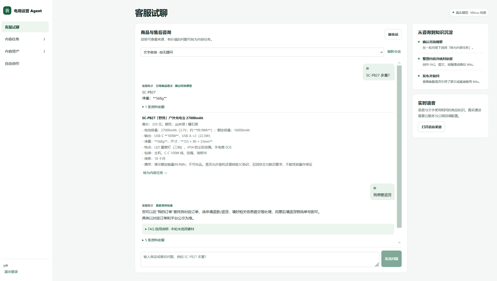
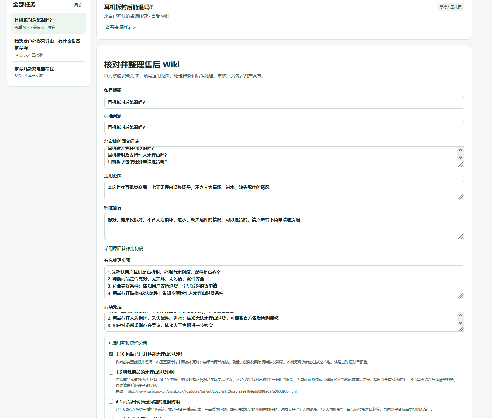
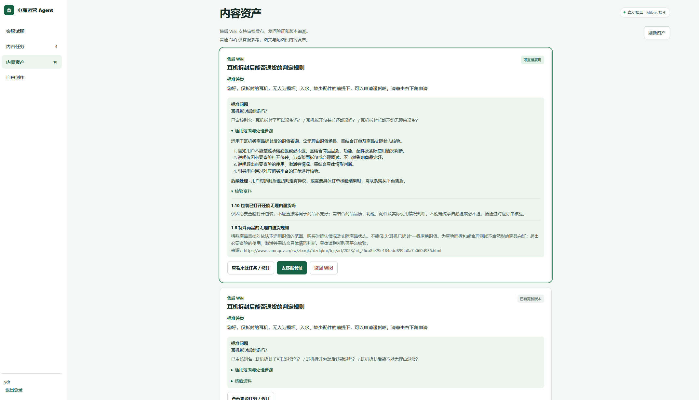
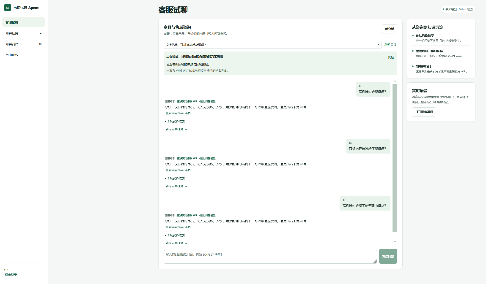
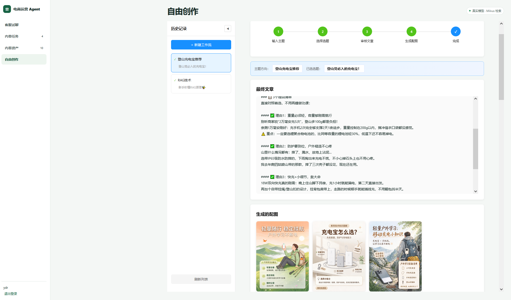
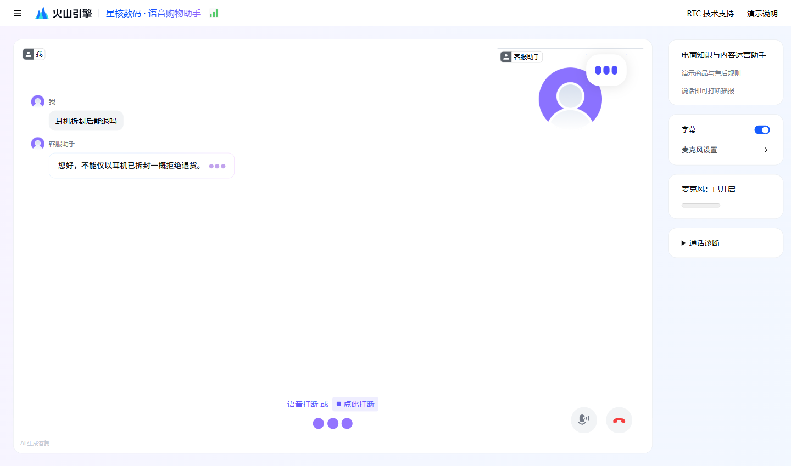
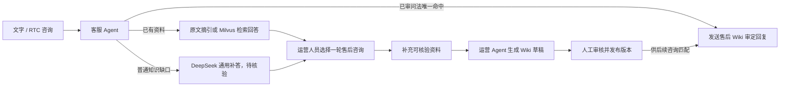
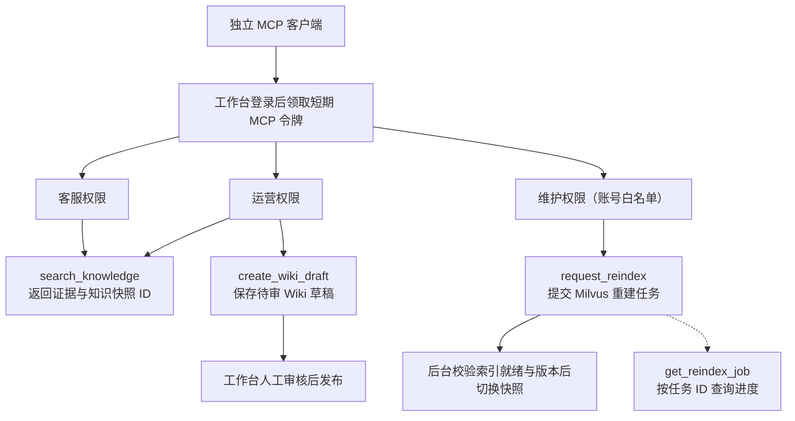

# 多Agent运营协同平台

## 项目简介

面向电商运营，把客服咨询、证据约束的图文创作、人工审核和知识复用接到同一工作台。客服遇到知识缺口时，可用 DeepSeek 先提供通用建议。运营再把有复用价值的售后咨询转为 Wiki 任务，补充依据、审核并发布。相同问题再次明确命中已审问法时，客服直接发送标准回复，跳过本轮向量检索和回答模型。

**技术栈** · FastAPI · LangGraph · MCP · PostgreSQL · Milvus · Vue 3 · React · DeepSeek · 火山引擎 Ark / RTC



## 项目亮点｜从 DeepSeek 补答到售后 Wiki

1. **客服先回应知识缺口。** 真实模式下，普通咨询缺少可靠资料时，客服可调用 DeepSeek 给出通用解释或排查步骤。工作台显示「DeepSeek 辅助 · 未经资料核验」。商品规格、商家政策和订单状态仍须通过对应资料或平台核验。
2. **运营 Agent 根据补充资料整理 Wiki。** 对适合沉淀的售后问题，运营人员点击「转为售后 Wiki 任务」。原回答保留为待核验线索，草稿依据另行核对的手册、公告或其他可靠资料生成。运营 Agent 预填标准问题、同义问法、适用范围、标准回复与处理步骤。
3. **人工审核发布后，客服直接复用。** 运营人员核对资料和措辞，批准草稿，再到「内容资产」发布。当前账号和知识快照下，标准问题或审核过的别名唯一命中时，客服直接返回审定回复并展示出处。 [审核与发布流程](docs/SUPPORT_WIKI.md)

例如，遇到知识库尚未覆盖的固件故障，DeepSeek 可先给顾客通用排查步骤。运营核对对应型号的官方手册或更新公告后，可把适用版本、操作步骤和升级条件整理为正式售后条目。

## 四个模块

- **客服试聊**提供文字与实时语音咨询。可核对的商品规格和常见退货条件直接引用当前资料。其他问题可使用已发布的售后 Wiki、原始资料检索或 DeepSeek 辅助答复，界面显示回答路径与可用来源。
- **内容任务**从单轮咨询提取运营线索。支持证据约束的图文和 FAQ 创作，也支持生成售后 Wiki 草稿，预填标准问题、同义问法、适用范围、标准回复及处理步骤。运营可修改草稿，一键批准审定版本。
- **内容资产**保留审核正文、出处与版本。运营可发布、修订或撤回 FAQ 和 Wiki，也可从资产页发起一次客服验证。
- **自由创作**提供独立的选题、撰写、修订和配图流程。文本创作可在人工选题及审稿处暂停，配图使用可配置的火山方舟图像生成服务。

## 演示

项目演示视频：[Bilibili](https://www.bilibili.com/video/BV1vEyHz1EPn/?share_source=copy_web&vd_source=1a998e24487e6f6983718867679d73a7) · [飞书](https://my.feishu.cn/wiki/KJ42wpvOtiqWuYkqjmkc1hFcnue?from=from_copylink)

### 1. 从咨询到审核

在客服回答下点击「转为内容任务」，选择「售后 Wiki」。系统用选定资料预填待审草稿，运营核对并修改后点击「批准 Wiki 草稿」。



### 2. 发布审核版本

批准后在「内容资产」查看标准回复和来源，点击发布。后续复用的是发布版本中人工审定的标准回复。



### 3. 客服复问命中 Wiki

点击资产里的「去客服验证」，发送预填的问题。标准问题或已审核别名明确命中时，客服提示「直接复用售后 Wiki · 跳过回答模型」。点击「查看本轮 Wiki 条目」可回到上一步的已发布资产。



<details>
<summary>自由创作与图文成果</summary>



</details>

<details>
<summary>实时语音与通话字幕</summary>

文字和实时语音共用客服知识与回答规则。通话完成的咨询可在同一账号下查看，并进入内容任务流程。



</details>

## 处理与存储



- **客服 Agent**按问题选择售后规则、商品原文、已审 Wiki、检索生成或 DeepSeek 补答。实时订单操作、安全事件和客服身份等场景由应用内规则处理。
- **内容 Agent**用 LangGraph 串联创作、事实检查与人工审核。检查覆盖 SKU、数值和单位、明确的政策条件及引用。PostgreSQL 持久化审批状态、创作检查点和幂等操作，支持刷新后继续审稿。
- **知识资产**由 PostgreSQL 保存结构化 Wiki、来源、审核版本和发布状态。Milvus 索引原始资料，用于召回与溯源。撤回条目或切换知识快照后，回答链路会排除失效版本。 [售后 Wiki 的回答顺序与发布规则](docs/SUPPORT_WIKI.md)

文字和语音共用回答逻辑，会话记录各自保存。客服根据当前会话和已有的关联记录处理「这两款」「第二款」等指代。售后咨询可沿用已明确的购买对象，或根据用户的明确指代查找商品。选购条件不明确时，客服按用途给出可核验的候选，或先确认偏好。

## 本地运行

以下命令从仓库根目录执行，依赖 Python 3.13、uv、Node.js 24 和运行 Linux 容器的 Docker Desktop。

```powershell
cd backend
uv sync --frozen
cd ..\frontend-ops
npm ci
cd ..
.\start.cmd -SkipVoice
```

打开 [工作台](http://127.0.0.1:5178) 并自行注册。启动脚本生成本地数据库密码和应用密钥，使用 PostgreSQL、演示资料字面检索和模拟模型，可以体验文字与内容审核主流程。演示模式的语音卡片会显示真实语音的启动方法。[本地 API 文档](http://127.0.0.1:8010/docs)

使用自己的云账号接入真实文本、Embedding、配图和语音。以 [环境变量示例](backend/.env.example) 为参照补充私有配置，保留首次启动生成的数据库和应用密钥。

- **DeepSeek 辅助回答**　启用此功能需要在本地 `backend/.env` 填入自己的 `DEEPSEEK_API_KEY`，并在真实模式下重启后端。密钥只保存在 Git 忽略的本地配置中。演示模式无需配置密钥。 [配置示例](backend/.env.example)

  ```dotenv
  DEEPSEEK_API_KEY=
  DEEPSEEK_MODEL=deepseek-flash
  DEEPSEEK_REASONING_EFFORT=low
  ```
- **Milvus**　初始化本地配置后运行 `docker compose --profile vector up -d --wait`，再从 `backend` 执行 `.\.venv\Scripts\python.exe -m app.fusion.knowledge --sync-milvus`。首次建索引调用真实 Embedding。单独同步索引后，可在启动真实文字服务前设置 `$env:FUSION_ACTIVATE_RETRIEVAL = 'milvus'`，再运行 `.\start.cmd -Live -WithVector -SkipVoice` 激活使用。 [知识快照说明](knowledge/snapshots/README.md)
- **实时语音**　配置自己的 RTC、语音助手和 ngrok 回调，在 `frontend-voice` 运行 `npm ci` 和 `npm run build`。停掉普通模式后从根目录运行 `.\start-voice.cmd -NgrokExe (Get-Command ngrok).Source -CheckOnly`，预检通过后去掉 `-CheckOnly` 启动。启动检查通过后，在工作台打开语音页并手动拨号。[配置与验收指南](docs/MANUAL_ACCEPTANCE.md)

关闭普通模式用 `.\stop.cmd`，关闭语音模式用 `.\stop-voice.cmd`。追加 `-StopInfrastructure` 可同时停止本工程容器并保留数据库卷。

## MCP 知识工具

工作台后端通过 MCP Streamable HTTP 向独立客服或运营客户端提供工具。客户端先用工作台登录凭证调用 `POST /api/v1/mcp/token`，请求体传入 `{"scope":"knowledge"}`、`{"scope":"operations"}` 或 `{"scope":"maintenance"}`，再用返回的 15 分钟 Bearer 凭证访问对应的 MCP 入口。



- `/mcp/knowledge/` 提供只读 `search_knowledge`，返回资料引用和知识快照 ID。
- `/mcp/operations/` 复用 `search_knowledge`，并提供 `create_wiki_draft`，为当前账号已有的售后 Wiki 任务生成待审草稿。草稿可以在工作台继续编辑、审核及发布。
- `/mcp/maintenance/` 提供 `request_reindex` 与 `get_reindex_job`。要启用该入口，在后端 `.env` 的 `FUSION_MCP_INDEX_OPERATORS` 设置允许运维的工作台账号 UUID，可从 `GET /api/v1/auth/me` 获取。多个账号使用逗号分隔，保存后重启服务。任务只能指向服务端已准备的 Milvus 快照，可能产生 Embedding 调用费用。后台核验索引就绪和当前快照版本后切换，已过期的任务会显示 `superseded`。Wiki 发布与撤回在原业务流程中完成。

本地启动后，可用官方 MCP Python SDK 客户端验证检索。草稿示例中的任务 ID 和证据 ID 可在工作台已有 Wiki 任务的接口响应中查看，`--evidence-id` 可重复指定。命令会提示输入工作台密码。

```powershell
.\backend\.venv\Scripts\python.exe scripts\mcp_client.py --username demo search 'SC-PB27 多重' --sku SC-PB27
.\backend\.venv\Scripts\python.exe scripts\mcp_client.py --username demo draft 'Wiki任务ID' --evidence-id '任务证据ID'
```

原始资料更新时，维护人员可从 `backend` 运行 `.\.venv\Scripts\python.exe -m app.fusion.knowledge --prepare-milvus '本地语料.json'` 注册候选快照。该命令只写本地快照清单。重启后服务会加载新快照，维护客户端可用 `reindex '快照ID' '幂等键'` 提交任务，并用 `job '任务ID'` 查询状态。

## 测试与实现范围

```powershell
.\backend\.venv\Scripts\python.exe scripts\run_tests.py
node --test --test-isolation=none frontend-ops/src/*.test.js frontend-voice/src/fusion-voice.test.cjs scripts/callback-gateway.test.cjs
```

已在真实 Milvus 与模型环境验证原文引用、Wiki 草稿审核、发布、复用与撤回；RTC 使用合成音频作为浏览器输入，验证 ASR、下行语音、挂断重连及语音咨询转任务。仓库示例使用虚构商品和政策，演示范围为咨询、创作与内部发布。[验收记录](docs/MANUAL_RESULTS.md)

## 仓库结构

- [`backend/app/fusion/`](backend/app/fusion/)　咨询、知识快照、事实校验、内容资产及语音适配
- [`frontend-ops/`](frontend-ops/)　运营工作台与自由创作
- [`frontend-voice/`](frontend-voice/)　独立构建的 RTC 通话页面
- [`knowledge/snapshots/`](knowledge/snapshots/)　演示资料及快照说明
- [`scripts/`](scripts/)　本地配置、服务启停与验收脚本

[产品需求](docs/01_PRD_电商运营Agent融合方案.md) · [技术与架构](docs/02_技术与架构_电商运营Agent融合方案.md) · [第三方代码及来源](THIRD_PARTY_NOTICES.md)
