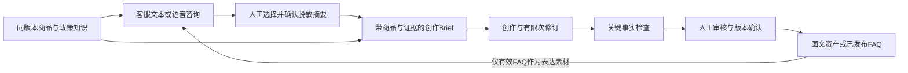

# PRD：商品知识与咨询反馈驱动的电商运营 Agent

- 文档版本：1.0
- 编制日期：2026-11-20
- 文档状态：设计基线，正文保留 2026-11-20 制定时的时态。2026-11-21 已开发交付，真实语音待用户手测；最新进度见 [实施状态](IMPLEMENTATION_STATUS.md)。
- SDD 定义：Spec-Driven Development，先明确需求与验收，再固定契约、实现任务和测试证据。
- 配套文档：[技术与架构](02_技术与架构_电商运营Agent融合方案.md)、[Roadmap](03_Roadmap_电商运营Agent融合方案.md)。
- 本次授权范围：分析与三份方案文档；不修改两个原项目，不启动融合开发，不改简历。

## 1. 可行性结论与推荐方案

**结论：有条件可行，建议融合；先验证最小业务闭环，再投入完整改造。**

推荐建立一个新的「电商运营 Agent」项目，以商品事实知识为共同基础，连接客服咨询、咨询转创作任务、内容生成与审核、审核后 FAQ 素材复用。复用创作 Agent 的工作流与账号基础，提取客服的检索和 RTC 接入能力。两个原项目继续作为只读基线。

按用户补充，优先通过新增一个「咨询转内容任务」联动模块实现整合：它承接咨询线索、商品证据、创作任务及审核资产的关联。共享知识与事实检查是这个联动功能的必要支撑，不要求先做第三个通用平台项目。最终验收包含“可作为简历上的一个综合项目”：一个新工程、统一产品名称与演示入口、可实际运行的跨模块链路；客服和创作成为其子模块，不再以两个互不相干的项目呈现。

“一个 Agent 项目”指一个产品目标、一套核心数据契约、一条可追溯的跨模块业务链路；不要求所有功能塞进同一个图、同一个模型会话或同一个进程。客服问答保留短路径，创作采用可中断的长流程。

### 1.1 为什么业务上能够结合

电商运营者既要回答“这款商品有什么参数、适用哪些规则”，也要针对反复出现的问题制作商品介绍、选购指南和 FAQ。两者共同依赖准确的商品与政策知识。咨询可以成为内容选题的来源，审核后的内容可以成为后续咨询的表达素材。

本方案首先实现运营者在同一工作台内试聊、挑选问题并制作内容；不把现有演示系统描述为已经服务真实商家，也不宣称新增流程已带来转化率、收入或客服人效收益。

### 1.2 方案选择

- **采用：共享知识服务 + 咨询到创作任务的桥接 + 人工审核的内容资产。** 存在真实的数据依赖，新增工作集中在证据贯通与事实检查。
- **不采用：只把两个页面放进同一个菜单。** 这只能算统一入口，不足以成为本次融合交付。
- **不采用：先造通用 AI 中台、再接两个应用。** 当前仅有两个场景，缺少建设租户管理、通用插件、动态编排平台的必要性。
- **不采用：让多个自治 Agent 相互讨论，或者让实时语音逐轮等待创作流程。** 这些不是完成业务目标的前置条件。
- **后备方案：仅调整简历。** 若 Roadmap 的早期验证无法证明知识复用和任务桥接，或工作量明显超过预算，则保留原项目，回到简历取舍与排版。

## 2. 现有能力、缺口与边界

### 2.1 智能客服已具备

- 商品型号精确匹配、政策语义召回；演示资料包含 34 个 SKU、89 个知识单元。
- Milvus 入库、语料与 Embedding 配置版本隔离、来源信息和幂等写入。
- FastAPI 服务、火山 RTC CustomLLM、OpenAI 风格 SSE 回调。
- 多轮用户提问补全、未知型号拦截、未接入订单等业务的固定边界答复。

限制：商品与店铺为虚构演示数据；会话主要保存在内存；没有真实订单、库存、退款办理与人工坐席；没有咨询到创作的任务桥接。

### 2.2 创作 Agent 已具备

- Vue 3 工作台、JWT 登录、工作流归属校验。
- LangGraph 选题、写作、质量检查、有限修订、人工审稿及配图。
- PostgreSQL 检查点、失败重试、版本对比、正文流与检查事件隔离。

限制：没有共享商品知识、商品绑定、事实证据检查、咨询转任务或 FAQ 回用。现有质量检查主要检查篇幅、栏目、保留文本和语义需求，不能当作商品事实核验。

### 2.3 本次必须新增

统一的知识快照与证据契约、持久化咨询摘要、人工确认的咨询转 Brief、证据驱动的创作节点、有限范围的事实检查、FAQ 发布/撤回与版本失效、跨模块 Trace 和集成验收。

## 3. 产品目标与成功判据

### 3.1 产品目标

1. 一份商品与政策资料能够同时支撑客服回答和内容创作，避免两边分别维护事实。
2. 从一条被人工选中的咨询，直接建立带商品、问题、来源和要求的创作任务，减少手工复制与事实遗漏。
3. 创作输出能够展示所用证据，关键事实有检查结果，人工批准后形成可追溯资产。
4. 已发布 FAQ 可以被客服作为受限的表达素材使用；原始知识始终是事实依据。
5. 在不损害原有演示能力的前提下，保留语音渠道、人机协同、恢复与排障证据。

### 3.2 不以这些指标作为本次成功条件

不预设“提升转化率”“节省百分之多少人力”“支持生产高并发”等结果。没有真实用户实验和线上数据时，不提供这些结论。研发完成的成功条件是第 9 节的可复现验收，而不是项目名称变化。

## 4. 用户与范围

### 4.1 V1 的主要用户

单店演示环境中的运营者：使用客服试聊验证问题，挑选有价值的咨询，创作并审核内容。保留至少两个独立账号的隔离验证；每个账号拥有自己的工作空间和内容资产。

本期没有真实消费者公开入口、复杂组织权限或商用多租户承诺。RTC 房间由登录运营者创建并绑定自己的会话。

### 4.2 V1 必须完成

- 统一工作台中的文本咨询、咨询记录、创作任务、审核与内容资产入口。
- 两条路径调用同一知识服务、同一知识版本和同一证据格式。
- 人工选择咨询后，系统创建结构化 Brief 并关联原咨询，不依赖复制粘贴。
- 有证据的 FAQ 与图文草稿生成；两种内容类型都可以进入人工审核。
- 检查商品型号、可结构化数值与单位、政策适用范围，明确“冲突/缺证据/通过”的区别。
- FAQ 单独发布、撤回和版本失效，客服回用留证。
- 原有配图能力继续保留；单次验收可以关闭配图，但最终交付须验证其失败与重试路径。
- 真实 RTC 渠道通过新系统的会话绑定接入；不因文本闭环完成而宣称语音已融合。

### 4.3 本期明确不做

- 真实订单、库存、支付、退款、发券和人工坐席。
- 自动发布到小红书等外部平台；这里的“发布”仅指进入系统内 FAQ 素材库。
- 自动采集外部客户聊天、全量会话挖掘、自动聚类和热点预测。
- 将生成文章自动回灌为商品或政策事实。
- 自研 ASR/TTS、通用事实核验、自动识别全部隐私信息。
- Kubernetes、消息总线、独立模型网关、通用多 Agent 中台及迁移评测中台项目。

## 5. 核心场景与业务流程

### 5.1 主演示场景

运营者在客服试聊中问“SC-PB27 多重”，再追问“那尺寸呢”；系统根据当前知识回答并展示证据。运营者选择其中一条问题，点击“转为内容任务”，确认目标人群、要解释的问题和引用范围。创作流程生成有证据的 FAQ 或图文，检查关键事实，等待人工审核。运营者可以驳回修改、比较版本；批准的 FAQ 单独发布后，客服针对相近问题可以复用其表达，并仍引用基础资料。

演示值以知识快照实际内容为准，不把示例文字硬编码成通过条件。

### 5.2 不允许跨越的边界

- 客服对话中的“帮我发布文章”等文字不是运营指令，不能直接触发发布或修改知识。
- 咨询摘要是选题线索，不是商品事实。用户说“这款只有 100g”，不能改变商品知识。
- 内容草稿与 FAQ 都是派生资产，不得覆盖原始商品与政策资料。
- 自动检查通过仍需人工批准。原创作图中的“审稿通过并进入配图”不等于 FAQ 已发布。
- 商品知识发生变化后，旧审核不能无条件用于新版本；失效资产不得继续被客服选用。

## 6. 功能需求

### FR-01：统一身份与工作空间

复用创作端账号基础。会话、咨询摘要、任务、版本和 FAQ 必须有服务端确定的归属；所有读写和流连接都校验归属。客户端提供的 ID 不能替代授权。V1 为每个账号独立工作空间，不实现成员协作系统。

### FR-02：共享知识与证据

客服、选题和写作统一使用 KnowledgeService。每次任务固定 `knowledge_snapshot_id`，每条引用携带来源、知识单元 ID 和内容哈希。演示基础知识可共享只读；生成资产不得写入基础知识集合。

### FR-03：客服文本与语音

保留精确型号匹配、政策召回、缺证据答复和业务边界。新增正式文本咨询接口与会话记录；现有 `/debug/chat` 不直接当作正式业务 API。RTC 回调继续使用其约定的 SSE，不能返回创作工作台事件或等待人工审核。

### FR-04：人工选择咨询并创建线索

运营者选择单条或少量同会话咨询，系统生成可编辑摘要；提交前展示将保存的内容，并移除已识别的手机号、邮箱等直接标识。仅保存摘要、必要引用和关联 ID；不自动保存音频或完整私人聊天。脱敏检测不确定时要求人工删除敏感内容。

### FR-05：从线索创建证据化 Brief

Brief 包含咨询来源、问题、目标读者、内容类型、商品范围、知识快照、证据引用和现有篇幅/栏目要求。显式未知型号、商品不明确或知识未就绪时先澄清。创建后可直接进入选题/创作流程，不要求再次手工搬运问题。

### FR-06：复用创作工作流

保留选题、写作、有限次质量修订、人工审稿、文章版本与配图。新流程在选题/写作前补充证据，并在原质量检查后增加事实检查。图文与 FAQ 使用不同内容格式要求，但复用工作流基础，不新建多个自治 Agent。

### FR-07：有限范围的事实检查

检查 SKU、知识中可提取的数值/单位与明确政策限定；写作输出的关键事实必须能对应基础证据。检查器须独立扫描最终正文，不能只检查生成模型主动声明的 claims，避免漏报错误绕过检查。结果分为 `pass / conflict / unsupported / needs_review`。关键事实冲突和缺证据时禁止 FAQ 发布；一般性文案仍由人工审核，不能宣称已经完成通用语义事实证明。

### FR-08：FAQ 审核与内部发布

发布单元是某个不可变 FAQ 版本。发布时再次核验归属、正文版本、知识版本和事实检查结果，保存批准人、时间和内容哈希。客服仅可选择同工作空间、有效知识版本、处于 published 状态的 FAQ，且不能用 FAQ 支持基础知识未覆盖的新事实。

### FR-09：版本变化与撤回

修改正文产生新版本并清除旧批准的适用性；更新基础知识后，依赖旧知识的 FAQ 标为 stale；撤回立即使其退出客服选用。旧版本保留审计信息。V1 不自动将旧内容升级为新知识版本。

### FR-10：恢复、幂等与失败处理

人工中断后允许刷新与重启恢复。创建任务、审核、发布支持幂等请求；同一工作流禁止并发推进。断线时至少能重新查询最新状态，不承诺重放全部历史 Token，也不承诺服务重启后后台任务自动完成。外部图片调用重试可能产生额外费用，应留证。

### FR-11：可观测与评测

咨询、线索、任务、文章版本、FAQ 之间可以关联追踪；记录知识与模型配置、检索来源、事实检查、人工决策、运行模式、耗时和用量来源。自动测试、真实模型、真实 Milvus、真实 RTC 的证据分别标注。

### FR-12：独立交付与诚实表述

在新目录构建和运行，使用独立数据库/Schema、Milvus 集合和配置，不写两个原项目的运行数据。保留上游许可与来源说明；融合功能通过验收前，不将原项目指标冒充新系统结果，不在简历宣称已完成融合。

新增联动模块属于同一综合项目内部能力，不另占一个简历项目。完成后，项目说明按统一业务目标、跨流程数据与结果组织；代码目录可以保留领域模块边界，不强行把所有前后端源码合成一个文件或构建。

## 7. 界面信息结构

- **客服试聊**：问题、答复、证据来源、当前知识版本、文本/语音状态；有“选择为内容线索”入口。
- **咨询线索**：人工确认后的摘要、商品范围、处理状态与关联任务；不建设自动热点大盘。
- **内容任务**：Brief、候选选题、正文版本、事实检查、现有质量检查、人工驳回/批准与配图。
- **FAQ 素材**：draft / published / stale / revoked 状态、证据与版本、内部发布/撤回。
- **运行详情**：跨模块关联和失败信息。开发用协议字段不放进主要操作流程。

## 8. 非功能要求与测量口径

- 持久化：咨询摘要、任务关联、资产与批准记录进入数据库；LangGraph 检查点不能替代业务资产表。
- 权限：两个独立账号的会话、任务、流和资产互不可访问；RTC 会话不通过可猜测房间号授权。
- 可靠性：知识不可用时明确失败或缺证据；不得静默切到 Mock 后显示真实模式。
- 实时性：RTC 路径不依赖创作运行。角色帧、正文首字、用户可听首音分别记录，不混称。
- 性能验证：在同一环境、同样样本下比较新旧文本/回调链路；记录样本数、中位数、P95 与失败数，不把少量样本 P95 当生产 SLA。首轮技术验证后确定可接受差值；相对退化超过 20% 时必须解释和处理后才能发布。
- 成本：设置有限修订、请求超时与调用准入预算；记录实际返回或估算的 Token 来源。准入预算不是供应商费用硬上限。
- 数据：默认不存原始音频；演示使用合成或已确认可用的问题。删除工作空间数据时同步处理关联快照中的敏感副本。

## 9. 验收规格与需求追踪

以下为待实现的交付门槛，不是当前通过报告。对应测试设计和证据位置见 Roadmap。

- **AC-01（FR-01）身份隔离**：账号 B 不能查询、续跑、订阅账号 A 的咨询、任务或资产；RTC 伪造会话映射失败。
- **AC-02（FR-02）知识复用**：同一商品在客服与创作路径使用同一个快照与可核对的证据 ID，无双份手工商品维护。
- **AC-03（FR-03）回答边界**：未知型号、缺证据、实时库存/订单请求、检索不可用均有预期处理，不伪装执行成功。
- **AC-04（FR-04）线索确认**：必须人工确认摘要；指定测试样本中的手机号/邮箱不进入创作模型输入、已确认线索和普通日志；不支持自动录音入库。此项不表示云端 ASR 从未处理原始语音，也不承诺识别所有隐私类型。
- **AC-05（FR-05）真实桥接**：从咨询一键建任务，服务端保存 session → insight → task → source refs 关联；刷新后仍可追溯。
- **AC-06（FR-06、FR-10）工作流恢复**：选题与审稿处重启应用后可继续；重复或并发恢复不会重复推进到不同版本。
- **AC-07（FR-07）事实检查**：故意注入错误 SKU、错误数值/单位、遗漏政策条件及不存在引用，分别被发现；关键问题未处理不能发布。
- **AC-08（FR-08）发布绑定**：没有人工批准、批准版本不匹配或事实检查未通过时拒绝发布；有效发布可被后续咨询实际选用并显示基础证据。
- **AC-09（FR-09）失效与撤回**：知识更新、正文改动、FAQ 撤回后旧批准或旧 FAQ 不能继续生效。
- **AC-10（FR-10）幂等和故障**：同幂等键重复创建/发布只产生一份对象；中途失败可见，图片重试和生成请求的重复风险有记录。
- **AC-11（FR-06、FR-10）流隔离**：正文不混入检查 JSON；不同 run 和文章版本不串流；断线后可通过状态快照恢复界面。
- **AC-12（FR-03）语音集成**：真实 RTC 通话、ASR/TTS、插话、挂断重连和回调鉴权通过；HTTP 模拟回调不能替代此项。
- **AC-13（FR-11）评测证据**：完成固定融合场景集、原能力无回归比较、至少一条真实文本闭环和一条真实语音闭环；Mock 与真实结果分开。
- **AC-14（FR-12）可交付性**：新目录独立启动、凭据不入库、许可证保留、原项目与原数据库不被迁移/覆盖，文档可指导复现。

## 10. 完成后才成立的项目叙述

达到全部 V1 门槛后，可以将两个原项目作为一个新项目的历史基础，围绕“共享知识—咨询转任务—证据化创作—审核资产复用”介绍融合系统，展开人机协同、检索治理、事实检查、语音集成与恢复能力。

若只完成共享页面或代码搬迁，仍只能描述为整合原型。原客服题库结果、原创作 20 例结果继续属于历史项目，不改名为融合系统成绩。是否将简历压到两页仍需单独做内容与版面取舍，融合本身不会自动节省简历篇幅。

## 11. 需求来源与待实施确认

本方案基于以下只读源码快照目录；所有新增需求均在本文件标为本次建设内容。

- 客服：`../项目1Ai语音对话智能客服项目/rtc_basic-main-8decc9076f4683cfd741b4275e7c1e7ce029a4cd/`，重点为 README、`rag_llm_server/main.py`、`services/rag_service.py`、`services/milvus_service.py` 和 `docs/VALIDATION.md`。
- 创作：`../项目2自媒体运营Ai智能体/graph_xiaohongshu-master-9b8f479bd21512201eb7d74ed034cd05e4af28c2/`，重点为 README、`app/graph/workflow.py`、`app/graph/quality.py`、`app/api/v1/workflow.py` 和 `docs/VALIDATION.md`。

实施前在 P0 固定：可投入时间、真实云服务与可用额度、独立测试数据库/集合、当前依赖锁定结果。缺少这些条件不妨碍本轮判断可行，但会影响交付日期及真实语音验收。
