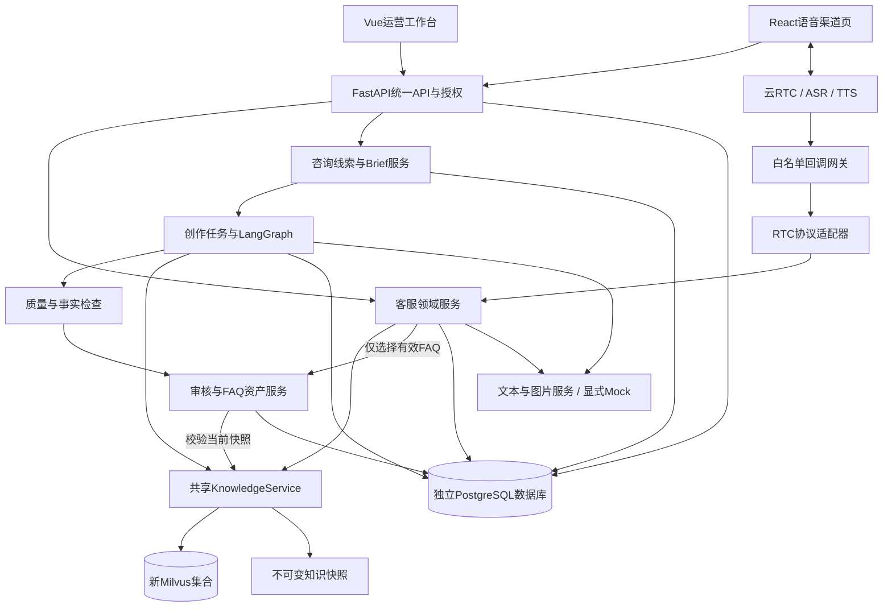
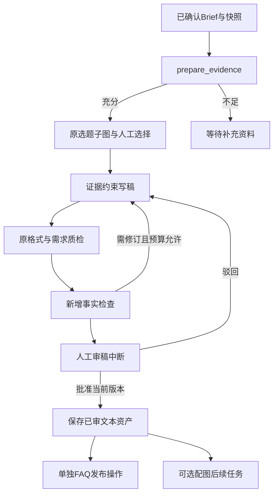

# 技术与架构：电商运营 Agent 融合方案

- 版本：1.0；日期：2026-11-20。
- 状态：设计基线，正文保留制定时的时态；2026-11-21 已开发交付，实际工程位于 `项目融合/电商运营Agent`。当前实现、取舍及待用户手测项见 [实施状态](IMPLEMENTATION_STATUS.md) 和 [验收映射](AC_TRACEABILITY.md)。
- 关联：[PRD](01_PRD_电商运营Agent融合方案.md)、[Roadmap](03_Roadmap_电商运营Agent融合方案.md)。
- 适用范围：单店演示、账号独立工作空间、共享只读演示知识；不承诺商用多租户或高可用。

## 1. 架构决策

### ADR-01：新项目、模块化单体

本方案以独立融合工程为交付边界。源码按领域迁移和适配，保留上游许可与出处。禁止直接在原项目中重构，也禁止把新系统连接到原数据库、原 Milvus 集合后试跑迁移。

首版采用一个 FastAPI 主应用、一个 PostgreSQL 实例中的独立数据库、一个新 Milvus 集合。领域边界在代码中明确，不先拆微服务。RTC 公网回调网关作为协议边缘组件保留，不等于建设分布式业务中台。

### ADR-02：两种工作流，共享领域能力

- 客服：授权与边界判断 → 追问补全 → 共享知识检索 → 可选有效 FAQ 素材 → 简短流式答复。
- 创作：线索/Brief → 同版本取证 → 选题 → 写作 → 质量与事实检查 → 有限修订 → 人工审核 → 内容资产；配图独立作为后续步骤。

客服不等待创作，不需要逐轮调用 LangGraph。创作继续使用固定业务图和生成节点，不宣称通用自治规划或多 Agent 协商。

### ADR-03：知识与派生资产分开

基础商品与政策是事实权威；FAQ 是受审核的派生表达资产，文章是运营内容。V1 的 FAQ 保存在 PostgreSQL，按 SKU、问题意图标签等简单条件筛选，不新增第二套向量索引，也不写进基础 Milvus 集合。

### ADR-04：前端分阶段统一

以 Vue 工作台为运营主界面。RTC React 页在首版保留独立构建与独立路由，由同一后端提供授权会话和知识能力。双前端构建不妨碍一个产品形成真实业务闭环；未来再抽取框架无关 RTC 适配器。

当前 `RtcClient.ts` 依赖 React 版组件提示、Apis 等，`useCommon.ts` 与 `listenerHooks.ts` 依赖 React/Redux，不能直接复制到 Vue 中运行。路由、静态资源基路径、身份引导和同域代理需要明确适配，不能只加 iframe 了事。

## 2. 源码核查与复用边界

以下路径相对于各自项目根目录，均为本次只读核查事实。

### 2.1 客服项目

根：`../项目1Ai语音对话智能客服项目/rtc_basic-main-8decc9076f4683cfd741b4275e7c1e7ce029a4cd/`

- `rag_llm_server/main.py`：实际 FastAPI 主服务；`Server/`、`server_python/` 为历史参考，不同时迁入。
- `services/rag_service.py`：`RagService.search(query)` 返回 query、retrieval_mode、version、sources、context，已有型号与政策分路。
- `services/milvus_service.py`：Embedding、向量校验、upsert、语料/模型配置过滤和来源核验。
- `services/commerce.py`：`retrieval_query` 仅用先前用户消息补全追问；`direct_answer` 明确未接入业务。
- `services/llm_service.py`：客服口语生成与政策限定语，不应直接作为长文写作器。
- `POST /api/chat_callback`：RTC 的 OpenAI 风格 SSE；角色帧、正文、结束与 `[DONE]`。
- `POST /debug/chat`：text/plain 流，不是新工作台可直接复用的标准业务 SSE。
- `/getScenes`、`/proxy` 和 `/debug/*` 不是面向公众的统一用户鉴权接口。
- `sessions`、`rtc_events` 为进程内状态；业务对话来自回调 messages，没有持久化业务会话关系。

**必须适配：** `corpus()` 当前为单份 JSON 缓存，检索未接受指定知识快照；现有 version 字符串不能单独证明事实一致。`sources` 没有保留完整逐块原文，而 context 是拼接字符串，需从快照原始知识单元构造逐项 EvidenceChunk，不能依赖切割提示词反推引用。

### 2.2 创作项目

根：`../项目2自媒体运营Ai智能体/graph_xiaohongshu-master-9b8f479bd21512201eb7d74ed034cd05e4af28c2/`

- `app/graph/workflow.py`：固定创作图、`interrupt`、`Command` 与人审路由。
- `app/graph/subgraphs/topic_selection.py`：候选选题和人工选择。
- `app/graph/utils.py`：AsyncPostgresSaver、连接池和生命周期。
- `app/graph/state.py`：AgentState，已有版本、质量历史、修订与指标；没有商品证据和咨询来源字段。
- `app/graph/quality.py`：ContentBrief 的篇幅、受众、栏目与保留文本；不是商品事实契约。
- `app/api/v1/workflow.py`：启动、恢复、重试与自定义 SSE。现有 thread_id 使用用户 ID 前缀，融合后增设显式归属表，不依赖前缀作为唯一授权。
- `app/services/llm_service.py`：通用内容创作提示词，需增加商品证据约束。
- `frontend/src/App.vue` 与 `version-diff.js`：可复用工作台交互与本地版本差异。

**必须适配：** 当前 approve 后进入配图，不等于发布；当前 SSE 是工作台自定义事件，不是 RTC ChatCompletion delta；当前质量检查没有事实核验；新增 thread 级并发推进控制。

## 3. 运行时与依赖基线

两个项目均声明 Python `>=3.13,<3.14`，新工程优先使用 Python 3.13、Node 22。以创作项目 `uv.lock` 作为候选解析基线，再迁入并验证客服模块，生成新工程自己的锁文件。

本次静态读取的创作锁文件版本包括：FastAPI 0.143.0、LangGraph 1.2.14、langgraph-checkpoint-postgres 3.1.2、Pydantic 2.14.0、httpx 0.28.1、psycopg 3.3.6。它们是本地锁定事实，不是对最新稳定版本的推荐。

客服 requirements 固定 FastAPI 0.115.0、Pydantic 2.9.2、httpx 0.27.2，不能与创作 requirements 简单拼接。尤其检查 Pydantic 校验、httpx 调用、SSE 取消和生命周期行为。原客服使用顶层 `from config`、`from services` 导入，新工程改为命名空间内绝对导入，不用修改 sys.path 拼接两个项目。

如果依赖验证无法在早期完成，可以暂以内部 HTTP adapter 保留客服独立进程作为过渡；这不是默认最终架构，也不能成为绕过共享知识与身份契约的理由。是否保留过渡部署须在 P1 记录决策。

## 4. 目标系统视图



核心复用在知识、证据和业务关联，统一模型 API 只是辅助，不作为融合成立的判据。

### 4.0 新增联动模块的最小实现

新增「咨询转内容任务」模块，以现有客服和创作能力为两端，新增 Insight → Brief → ContentTask 的桥接，调用共享 KnowledgeService，并把已审核 FAQ 与来源咨询关联。它是综合项目的内部功能，不是另一个需要单独运营、单独写入简历的第三项目。

实现顺序先围绕这一功能做纵向切片，随后补齐发布回用、恢复与语音渠道。对外统一名称、操作入口和数据追踪；对内保留领域与前端构建边界。中台化仅指复用这些公共能力，不扩展成通用 AI 平台。

### 4.1 建议目录

```text
电商运营Agent_融合版/
  backend/
    app/main.py
    app/core/                  # 配置、授权、生命周期
    app/contracts/             # 版本化Pydantic契约
    app/modules/knowledge/     # 快照、检索、Milvus adapter
    app/modules/consultation/  # 文本会话、业务边界
    app/modules/insights/      # 选择、脱敏、Brief桥接
    app/modules/content/       # 创作图、检查、版本
    app/modules/assets/        # FAQ审批、发布、撤回
    app/adapters/rtc/          # 云协议与业务身份映射
    app/runtime/               # 数据库任务运行器、互斥与状态
    migrations/
    tests/
    pyproject.toml
    uv.lock
  frontend-ops/                # Vue主工作台
  frontend-voice/              # React RTC页，首版独立构建
  knowledge/snapshots/         # 新副本，不指向原项目可变文件
  evals/                      # 固定融合用例与证据
  docs/
  compose.yaml
  THIRD_PARTY_NOTICES
```

本结构是未来实施建议，不表示本轮已建立这些目录。

## 5. 核心契约与数据模型

所有对象含 schema_version、创建时间与关联 ID。ID 服务端生成，时间使用 UTC 存储、界面按用户时区展示；机器 ID 与业务展示标题分开。

### 5.1 KnowledgeSnapshot

- `knowledge_snapshot_id`：不可变快照 ID。
- `corpus_sha256`、`normalization_version`：语料与规范化规则。
- `embedding_profile_id`：模型/端点配置指纹、维度和检索配置，不含密钥。
- `status`：building / ready / failed；仅 ready 可设为当前版本。
- `source_manifest`：来源文件、知识单元与哈希；数据保存到新工程独立位置。
- `active_snapshot_id`：数据库中的当前指针，切换原子化。

快照 ID 至少覆盖语料、规范化与检索配置，不只使用原有 `ecommerce-v1` 标签。创作固定一个快照；客服每次新问题使用当前 ready 快照。切换后将旧资产标为 stale，同时在读取路径实时校验快照，不能只靠异步标记来排除旧资产。

### 5.2 EvidenceChunk 与 FactBundle

```json
{
  "schema_version": "1.0",
  "knowledge_snapshot_id": "ks_<digest>",
  "chunk_id": "<原知识单元稳定ID>",
  "source_id": "<来源文件或规则ID>",
  "source_section": "<章节>",
  "sku": "SC-PB27",
  "content": "<快照中的完整事实片段>",
  "content_sha256": "<片段哈希>",
  "retrieval_route": "exact_sku",
  "score": null
}
```

精确匹配不伪造相似度分数。FactBundle 保存 evidence 列表及经人工/确定性解析确认的型号、字段、数值、单位、政策范围；保留原文。V1 首先为演示集建立有限的字段映射，不能将 LLM 自动抽取结果直接宣布为权威事实。

### 5.3 业务对象

- `Workspace`：owner_id；V1 每账号一个，不建设组织成员系统。
- `ConsultationSession`：workspace_id、owner_id、channel、当前状态；与 RTC room/task 的映射单独保存。
- `ConsultationTurn`：问题摘要、选用证据、快照、answer trace；模型暂存历史与持久化摘要区分。默认不记录原始音频。
- `Insight`：source_session/turn、人工确认的 sanitized_summary、商品范围、确认时间、linked_task_id。
- `ContentTask`：insight_id 可空、content_type=faq/article、商品范围、Brief、快照、thread_id、state_version。
- `ContentRun`：task_id、run_id、运行状态、互斥/租约信息、失败原因和指标。
- `ContentVersion`：不可变正文、父版本、引用、FactCheckReport、内容哈希、生成模式与模型配置。
- `ContentAsset`：类型、所绑定的正文版本、text_review_status、publication_status、image_status。
- `Approval/Operation`：批准人、正文哈希、快照、事实报告版本、操作幂等键与结果。

业务表使用显式外键关联。checkpoint 只保存执行状态，不作为跨工作流搜索、所有权和发布审计的唯一数据库。任务删除/数据清理需覆盖 checkpoint 中复制的摘要和正文，而不仅删除任务索引。

### 5.4 扩展后的创作状态

沿用现有 AgentState 的写作、版本与质量字段，新增 task_id、workspace_id、content_type、source_insight_id、product_refs、knowledge_snapshot_id、evidence_refs、fact_bundle_id、fact_check_report、state_version。

不要把整个客服历史、所有知识单元、用户密钥放进图状态。节点通过服务端授权后的 task_id 取业务数据；模型只看到最少的已确认摘要和证据。

## 6. 共享知识服务

拟新增内部接口：

```python
retrieve(query, *, snapshot_id, product_scope, purpose) -> RetrievalResult
get_fact_bundle(*, snapshot_id, evidence_refs) -> FactBundle
get_active_snapshot() -> KnowledgeSnapshot
```

- purpose 区分 consultation / topic / writing，控制上下文数量与长度；不改变同一事实来源。
- 政策语义召回与型号精确匹配继续分工；未知显式型号不能退化为相近 SKU。
- Milvus 使用新集合，例如 `commerce_ops_fusion_v1`；过滤条件由服务端绑定的快照生成，不接受模型拼接过滤表达式。
- 现有 scope、upsert 和 Embedding adapter 可迁移；新增按指定快照查询、快照就绪注册与并行读取旧快照的能力。
- 索引写入失败不得切换 active 指针；已有 ready 快照继续服务。
- 引用原文按 chunk_id 从不可变快照读取并核验哈希，不从拼接 context 中猜测边界。
- 新演示基础资料可以跨账号共享只读；咨询摘要、内容和 FAQ 必须按 workspace 隔离。

## 7. 关键流程与状态机

### 7.1 咨询转创作

1. 客服记录本次 trace、实际来源与快照。用户输入只是线索，不能修改事实。
2. 运营者选择问题、确认脱敏摘要与商品范围。
3. 服务端校验所选会话归属；相同幂等键只创建一个 Insight。
4. 从 Insight 创建 ContentTask，取得当前知识快照并取证；若与原咨询版本不同，界面明确展示差异，不能假装同一版本。
5. 固定创作快照与 FactBundle，交给持久化任务运行器；返回 task_id/run_id。

API 必须能处理明确指定商品范围的直接创作，不强制每个任务来自咨询；验收时必须有实际咨询桥接路径。

### 7.2 创作图的新增部分



关键事实未解决时，人工仍可查看或导出“未通过检查”的草稿，但不得发布为客服可用 FAQ。不提供“一键忽略全部事实错误”的发布入口。

需要改造原 `route_quality` 条件边：质量检查和事实检查都完成后，由统一路由汇总决定修订或转人工，合并两类反馈，并共用每轮/累计修订次数、Token 准入预算和超时。不得保留绕过事实检查的旧边，也不建立两个互相触发的修订循环。

选题与写稿提示词必须注入商品范围、引用契约、禁止补造的事实和业务承诺边界，替换当前通用“爆款”导向的相关约束。每个关键 claim 产生 source refs；普通文风不强制句句引用。

### 7.3 事实检查

- 输出 `claim_id / text_span / sku / field / normalized_value / evidence_refs / status / reason`。
- 独立扫描最终可见正文中的 SKU、目标数值/单位与政策限定，和模型上报 claims 做覆盖比对；模型没有主动声明的事实同样检查。扫描到未支持的目标事实表达时标记 needs_review，不因缺少 claim 对象就忽略。
- SKU 与数值单位采用确定性比对；单位换算建立白名单，不能仅比较字符串。
- 政策检查区分适用商品、开封/使用等条件；对固定演示规则建立人工确认的结构化条件，不假设程序能够理解全部自然语言合同。
- LLM 可辅助提出缺证据风险，但不作为覆盖确定性冲突的唯一裁判。
- 未知引用、引用内容哈希不符、关键事实冲突或缺证据均阻止 FAQ 发布。复杂语义标为 needs_review；核对后修正文案或补充合法基础资料，再重新检查，不直接把 unknown 改成通过。

客服实时流式答复不等同于“所有 Token 已经预先通过事实检查”；本期的硬发布门禁用于持久化内容资产。客服端保留证据约束、边界答复和评测，不能套用内容检查结果宣称实时回答零幻觉。

### 7.4 发布、配图与回用

- `text_review_status`：pending / approved / rejected。
- `publication_status`：draft / published / stale / revoked。
- `image_status`：not_requested / pending / running / partial_failed / completed / failed。

三组状态独立。图片失败不撤销已审文本，文本批准不自动发布 FAQ。发布在数据库事务内检查 task 状态版本、当前正文哈希、当前知识快照、事实报告与批准记录；同一资产版本唯一发布，重复请求返回原结果。知识激活与发布按相同锁顺序锁定 active-snapshot 指针和资产记录，或采用等效条件更新，避免“校验后知识刚好切换”的并发窗口；事务不包含模型调用。

客服先取得基础事实，再按 SKU/意图筛选有效 FAQ。只有其全部引用属于当前快照且仍有效时才可作为参考表达；FAQ 的新参数、新承诺不产生事实效力。没有匹配或资产服务失败时，回退基础知识答复，不阻塞客服。

FAQ 撤回后新请求立即排除；已发出的音频/Token 无法撤回，应记录撤回时间与正在进行的 trace，不承诺改变已经播出的内容。

## 8. API 规格草案

以下均为新接口，不表示现有项目已经提供。统一前缀 `/api/v1`，除专用云回调外均要求登录。

- `POST /consultations`：创建会话；返回 session_id。
- `POST /consultations/{id}/messages`：文本问答，fetch SSE；保存本次来源与模式。
- `GET /consultations/{id}`：恢复会话摘要与证据。
- `POST /insights`：从己方会话选择 turn 并提交确认摘要；Idempotency-Key 必填。
- `POST /content-tasks`：接收 insight_id 或直接 Brief、商品范围、内容类型；返回 202 与 task_id/run_id。
- `GET /content-tasks/{id}`：业务状态、最新正文、检查、待人工动作和 checkpoint 摘要。
- `POST /content-tasks/{id}/actions`：select_topic / reject / approve_text / retry，携 expected_state_version 与操作幂等键。
- `GET /content-tasks/{id}/events`：fetch 流连接，使用 Authorization header；先发当前状态，再发实时事件。
- `POST /assets/{id}/publish`、`POST /assets/{id}/revoke`：独立发布操作，绑定正文版本、知识快照与预期状态版本。
- `POST /voice/sessions`：创建已授权的 RTC 业务会话。
- `POST /callbacks/rtc/llm`：云服务凭据鉴权的 OpenAI 风格 SSE。
- `POST /callbacks/rtc/events`：验签事件入口。
- `GET /knowledge/active`、`GET /knowledge/snapshots/{id}`：受控的知识来源与就绪信息，不返回密钥。

鉴权失败返回 401；越权对象统一 404；重复推进/失效版本返回 409；非法输入 422；知识不可用 503 并附可理解错误码。幂等键必须同时绑定 owner、操作与请求内容哈希，同键不同内容返回 409。

### 8.1 工作台事件契约

`event_id、schema_version、trace_id、session_id/task_id、run_id、article_version_id、state_version、type、payload`。

type 包括 state_snapshot、answer_delta、article_delta、node_status、fact_check、review_required、run_completed、run_failed。正文、检查和不同版本分别路由。API 先查归属再建立流；不用 URL query 传 JWT。

V1 只保证重新连接得到最新持久化状态和之后的事件，不保证旧 Token 重放。event_id 用于去重与排障，不冒充完整事件日志。

### 8.2 RTC 协议与身份

RTC adapter 仅输出云服务要求的角色帧、content delta、结束和 `[DONE]`；不得夹杂工作台 JSON。先发角色帧不代表用户已听到有效回答。

RTC room_id、task_id 与内部 session/workspace/owner 建立服务端映射。回调凭据只证明云服务身份；还需从经验证的回调上下文解析所属会话，不能信任 messages 中声称的身份。P0/P1 必须用脱敏实际回调样本确认字段；若云回调不提供可验证关联字段，则为每个会话生成短期随机 callback handle 并服务端绑定、过期撤销，不能猜测 room_id。

React 页通过同域已认证初始化接口取得限时语音会话配置；若需要跨构建页面交接，使用一次性短期兑换码及服务端消费，不在 URL 放长期登录 Token。调试接口默认仅本机或关闭，公网网关白名单只转发需要的回调。

## 9. 运行器、并发与恢复

新增一个基于 PostgreSQL 任务表的轻量运行器，无需 Redis/Celery。API 在事务中先保存任务，再返回 202；单进程 runner 领取 queued run，以 semaphore 限制并发，后台执行图至结束或人工中断。SSE 是观察通道，不拥有任务生命周期。

- 初始部署一个业务进程；不能通过增加 Uvicorn workers 直接宣称支持扩容。
- 同 task 通过状态版本检查和租约保证只有一个推进者，数据库事务不跨越模型调用或人工等待。
- queued / running / waiting_human / completed / failed / interrupted / canceled 为 ContentRun 执行状态；资产状态单独管理。
- ContentRun 表示一次执行片段；启动、人工续跑或显式重试创建新 run_id，复用同一 task_id/thread_id，并关联 previous_run_id。到 waiting_human 表示该片段停止等待，不表示整个任务完成；任务的当前状态与最新 run 单独关联。
- 重启时过期 running 标记 interrupted 并显示可重试，不自动重放所有外部调用。waiting_human 从 checkpoint 恢复。
- interrupt 所在节点恢复时可能重新执行节点代码；发布、发起配图等副作用拆到独立步骤，使用稳定操作键。
- 幂等只保证本地业务对象不重复；第三方生成接口没有可验证幂等能力时，不能承诺一次扣费或完全一次执行。
- 图片默认沿用有限并发与有限重试，整批重试的语义在 UI 明示。
- 客服与创作使用独立的请求并发上限、超时和连接资源，避免长文/配图占满短问答通道。

## 10. 验证、可观测与证据分级

需求验收 ID 采用 PRD 的 AC-01～AC-14，不另造一套冲突编号。Roadmap 将每一项分配到具体阶段和证据。

证据分级：

- `offline_contract`：确定性规则、隔离、幂等、状态机和协议 fixture。
- `db_integration`：真实独立 PostgreSQL、checkpoint、runner、审批事务，模型可以 Mock。
- `live_retrieval`：真实 Milvus 与 Embedding；生成是否 Mock 单独标识。
- `live_text`：真实模型的咨询到内容发布回用闭环。
- `live_voice`：真实 RTC、ASR/TTS、插话/重连与上述知识路径。

每次报告保存代码版本、用例哈希、知识快照、模型配置、模式、样本数、原始 trace、失败原因、费用用量来源和日期。不记录密钥；普通日志记录 ID 与脱敏摘要，敏感正文进入受控存储而非随意打印。

现有 147 题客服回归包含关键词假阳性与已知失败，先保留原断言和逐例基线，不以“改词到全通过”验收。原创作 20 例主要验证机械约束，也不能作为商品事实质量结论。新增融合场景覆盖证据、错误参数、来源失效、权限和回流污染。

## 11. 风险与降级

- 知识快照尚未就绪：不启动事实创作；客服明确说明不可用，不伪装 sample/Mock 为真实检索。
- 云模型失败：已有摘要、草稿和证据保留；任务可重试或交人工，不发布残缺 FAQ。
- 复杂事实无法自动判定：标记 needs_review 并缩小可发布内容，不宣称事实全自动核验。
- FAQ 资产不可用：仅用基础事实回答，不影响基本咨询。
- 配图失败：文本资产继续可审核，配图状态单独显示。
- 公网 RTC 不可验收：交付状态停在文本版，不把 HTTP 回调测试写成语音完成。
- 单体依赖整合失败：先记录兼容问题，再决定过渡 adapter；若早期业务闭环收益不足，按 Roadmap 停止扩展。

## 12. 官方技术参考与版本使用原则

以下官方文档于 2026-11-20 核对概念；实现以新项目锁定版本、现有调用和测试为准，不直接复制当前文档的新 API 代替兼容验证。

- [LangGraph Interrupts](https://docs.langchain.com/oss/python/langgraph/interrupts)：人工中断、同 thread 恢复及副作用注意事项。
- [LangGraph Persistence](https://docs.langchain.com/oss/python/langgraph/persistence)：checkpoint 与跨线程业务数据的职责不同。
- [FastAPI Lifespan](https://fastapi.tiangolo.com/advanced/events/)：在主应用生命周期统一管理数据库、runner 与模型客户端；不假设简单挂载子应用就自动完成其资源初始化。

本文件中的实体、API、发布状态和 runner 均为本次设计。除第 2、3 节标明的源码事实外，不应把其余内容视为现有代码已经具备的能力。
