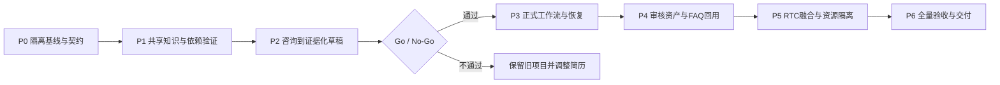

# Roadmap：电商运营 Agent 融合实施与交付

- 版本：1.0；日期：2026-11-20。
- 关联：[PRD](01_PRD_电商运营Agent融合方案.md)、[技术与架构](02_技术与架构_电商运营Agent融合方案.md)。
- 当前进度：本文件正文保留设计时路线。2026-11-21 开发与自动化已交付，M1/M2 已通过，M3 真实语音待用户手测；见 [实施状态](IMPLEMENTATION_STATUS.md) 和 [验收映射](AC_TRACEABILITY.md)。
- 实施原则：先完成跨模块纵向切片，再补全 UI、恢复、语音与交付。所有开发在新工程进行，原项目继续保留。

## 1. 交付结果与开始条件

最终交付不是“两个旧项目放进一个文件夹”，而是一个可独立运行的新工程，完成：

`同版商品知识 → 文本/语音咨询 → 人工确认线索 → 证据化创作 → 事实检查与人工审核 → FAQ发布 → 后续咨询实际复用`

还须交付可复现实验、独立配置、清晰的代码来源及真实演示。图文与配图保留；配图成功不作为 FAQ 发布的前提。

根据用户补充，新增建设以「咨询转内容任务」这一个联动模块为中心，不先造第三个通用中台。其验收结果是客服与创作在同一工程、同一产品下协作，完成后可以在简历上呈现为一个综合项目；内部模块数、前端构建数和进程数不作为“一个项目”的判定标准。

实施开始时在新工程固定以下信息：

- 两个来源目录与选取文件的哈希、来源说明、现有许可。
- 新数据库名、新 Milvus 集合名、测试资料目录和公网回调路径。
- Python 3.13 / Node 22、拟复用的锁文件、可用云服务和调用额度。
- 预期投入时间。下文约 8～15 个有效工作日为熟悉现有代码后的初步估算，不是承诺；不含云服务开通、排障等待或额外需求。

本轮不启动上述工作；需要后续明确开始实施。计划不要求为了每个常规任务再次做用户审批，但真实环境、费用和权限应在执行时遵循当时已有授权。

## 2. SDD 工作方式

每个阶段按以下顺序推进：

1. 选取对应 FR/AC，补充输入、输出、失败状态和示例。
2. 固定该阶段契约与关键验收样例，确定现有能力和新实现边界。
3. 实现满足需求的最小纵向切片。
4. 运行与改动相关的规则、数据库和集成检查，保存证据。
5. 对照退出条件判定完成；未通过不通过扩大范围掩盖问题。

规格发生变化时，同时更新 PRD、技术文档与本路线中的验收映射。重要决策记录“原因、取舍、影响”，不只修改代码。测试验证用户行为与失败边界，不为每个低影响样式改动增加镜像测试。

## 3. 依赖关系与里程碑

- **M0：方案就绪。** 本轮完成。
- **M1：融合价值成立。** P2 退出：知识复用、来源桥接、错误参数拦截已经能实际演示。
- **M2：文本版闭环成立。** P4 退出：审核 FAQ 能被后续咨询复用，并可撤回。
- **M3：V1 完整交付。** P6 退出：语音、恢复、隔离与复现全部有证据。

M1/M2 不是“完整语音融合版”。简历与 README 必须按真实完成阶段描述。

## 4. 分阶段任务

### P0：冻结来源、搭建隔离工程与规格基线

预估：0.5～1 日。

任务：

- P0-01：在新工程记录来源文件清单与哈希，不对原工程执行迁移、重构、安装或测试写入。
- P0-02：按白名单迁移必要代码副本，排除 `.env`、历史运行数据、原数据库、音频、node_modules 和虚拟环境；保留已有许可与来源说明。
- P0-03：固定新应用命名空间与代码目录，声明原 `Server/`、`server_python/` 不进入主运行链路。
- P0-04：建立 FR/AC 追踪文件，确认 KnowledgeSnapshot、EvidenceChunk、Insight、ContentTask、ContentAsset 的 schema 1.0。
- P0-05：准备独立测试数据库、知识副本与 Milvus 集合；清楚区分演示、测试和原运行数据。
- P0-06：确认真实 RTC 回调的可用身份关联字段，仅使用脱敏样本；字段不足时设计短期 callback handle。

交付：新工程骨架、来源清单、契约草案、环境样例和隔离检查。

退出条件：AC-14 的原项目隔离部分通过；所有测试与运行路径可解析到新工程与新资源，不依赖原目录中的可变文件或密钥。

### P1：验证依赖并提取共享知识服务

预估：1～2 日；依赖 P0。

任务：

- P1-01：以创作 `uv.lock` 为候选，迁入客服检索模块，解决 FastAPI/Pydantic/httpx 版本与导入冲突；冻结新锁文件。
- P1-02：封装 RagService/Milvus adapter，保留型号精确匹配、政策语义召回和未知型号边界。
- P1-03：建立不可变 KnowledgeSnapshot，新增按 snapshot_id 查询、ready 状态与原子 active 指针。
- P1-04：构造完整 EvidenceChunk 与有限 FactBundle；为演示集人工确认可检查字段及政策条件。
- P1-05：提供两个调用者的最小验证：客服回答器与创作取证节点，核对其知识快照和事实 ID。
- P1-06：先用 fixture 验证契约，再以真实 Milvus/Embedding 验证检索；结果分别保存。

交付：可调用的共享 KnowledgeService、独立知识集合、新依赖锁、检索与快照验证报告。

退出条件：AC-02、AC-03 的检索部分通过；同一 SKU 与政策在两条路径中使用相同来源；原集合不被修改；知识构建失败不切换当前版本。

失败处理：依赖整合若在约定的技术验证时间内无法完成，记录具体不兼容项。可验证内部 HTTP adapter 过渡路线，但仍要执行统一契约；不能长期靠 sys.path 和复制配置绕过问题。

### P2：构建最小融合纵向切片并决定是否继续

预估：1～2 日；依赖 P1。P0～P2 合计约 3～5 日，先验证价值，不先完善所有界面。

任务：

- P2-01：新增正式文本咨询接口，复用既有账号和归属校验，保存必要的来源与问题摘要。
- P2-02：完成“选咨询 → 确认脱敏摘要 → Insight → Brief → 创作任务”的服务端关联。
- P2-03：将选定商品、快照与证据接入写作，不只把问题复制到 topic_direction。
- P2-04：增加最小事实检查，至少能发现错误 SKU、错误数值/单位、明确政策条件缺失。
- P2-05：做一个最小操作页，展示问题来源、草稿、证据与检查结果；不先重做整套 UI。

M1 演示：咨询 `SC-PB27` 的参数 → 从该咨询创建内容任务 → 生成引用同一事实的草稿 → 故意改错关键数值 → 检查报告定位冲突。真实值来自快照，不通过硬编码样例获得通过。

退出条件：AC-04、AC-05、AC-07 的最小切片通过；AC-01 的关键对象归属通过。

**Go / No-Go 决策门：**

- Go：同一知识能够复用，来源关联持久化，错误事实被检查发现，工作量仍在可接受范围内。
- No-Go：最终只能展示页面并列/复制提示词；无法形成证据关系；或关键依赖、事实契约造成明显超预算。
- No-Go 后停止“中台”扩展，保留已完成原型和原项目；后续以简历压缩与排版为主，不将原型写成完成项目。

技术路线可以根据验证结果调整，但不得取消核心验收再宣布融合成功。

### P3：完善持久化工作流、修订与恢复

预估：2～3 日；依赖 Go。

任务：

- P3-01：扩展 ContentBrief 与 AgentState；证据准备进入选题/写作前，事实检查进入原质量检查后；改造原 route_quality，合并检查反馈与修订路由，共用次数和预算，不保留绕过事实节点的旧条件边。
- P3-02：支持 FAQ 与图文两种格式；保留原始需求、父版本和反馈，商品快照不随全局更新静默变化。
- P3-03：保留有限次修订、Token 准入预算与超时；关键事实未解决时清楚提示，不发布。
- P3-04：建立 ContentTask/Run 显式归属、状态版本和操作幂等键；新增轻量数据库运行器。
- P3-05：创作请求先落库返回任务 ID；图运行与 SSE 观察分离；刷新可获取最新状态。
- P3-06：增加同任务推进互斥、人工中断重启恢复、过期运行状态处理；不自动重放可能重复付费的副作用。
- P3-07：工作台区分正文、检查结果、run 与 article_version，沿用版本差异和指标展示。

交付：完整创作主流程、事实报告、状态恢复、版本 UI、数据库集成测试。

退出条件：AC-06、AC-11，以及 AC-07 的检查部分、AC-10 的任务幂等与故障部分通过；两项涉及 FAQ 发布的门禁/幂等留到 P4 补齐。至少一次真实 PostgreSQL 重启恢复验证。Mock 模型完成的恢复不标为真实模型效果验证。

### P4：内容审批、FAQ 发布回用与失效

预估：1～2 日；依赖 P3。

任务：

- P4-01：拆分文本审核、内部发布、配图三组状态，修改原 approve 后直接依赖配图的耦合。
- P4-02：实现当前正文版本、事实报告、知识快照与人工批准的绑定。
- P4-03：FAQ 发布事务与唯一约束，重复点击返回同一结果；不同请求内容不得复用同键。
- P4-04：客服按 SKU/意图选用有效 FAQ，保留来源；基础知识是唯一事实依据。
- P4-05：实现撤回、正文变更和知识切换的失效；读取路径再次校验有效性。
- P4-06：验证图片失败不阻塞已审文本、FAQ 不可用时基础问答仍可用。

交付：审核资产页、FAQ 发布/撤回、真实文本回用链路及失效测试。

退出条件：AC-08、AC-09，以及 AC-07 的发布门禁、AC-10 的发布幂等部分通过；完成“咨询→创作→人工审核→FAQ发布→后续咨询实际选用→撤回后不再选用”的 M2 演示。只保存一篇文章不算闭环完成。

### P5：复用 RTC，验证语音与长流程相互隔离

预估：1～2 日；依赖 P4。

任务：

- P5-01：将 RTC 主后端能力迁至 adapter，保留专用 OpenAI 风格回调 SSE；不得复用工作台自定义事件协议。
- P5-02：建立业务会话、owner/workspace、RTC room/task 或 callback handle 的绑定和过期撤销。
- P5-03：React 语音页独立构建，通过新后端授权初始化；处理同域路由、资源基路径和限时会话交接。
- P5-04：回调网关只转发白名单端点；debug 不对公网暴露，RTC 回调令牌不获得运营接口权限。
- P5-05：短咨询与创作限制独立资源；并发写稿/待审核/配图失败时测试咨询可用性。
- P5-06：真实麦克风与 RTC 验收，覆盖 ASR/TTS、插话、挂断重连与无证据答复。

交付：通过新知识服务的语音渠道、会话绑定、真实语音记录及延迟/错误报告。

退出条件：AC-01 的 RTC 映射、AC-03 的语音边界、AC-12 通过。没有云服务或公网回调条件时，状态标为“语音验收待完成”，不能跳过后宣布 M3。

### P6：回归、效果边界、复现与最终交付

预估：1～2 日；依赖 P5。

任务：

- P6-01：在新工程独立环境重跑相关原能力基线，逐例比较，保持历史失败与新增失败可区分。
- P6-02：运行固定融合场景集、权限/并发/恢复/撤回集成测试；保存配置与用例哈希。
- P6-03：完成真实 Milvus/Embedding、真实文本及真实语音证据，分开标注 Mock 与真实模式。
- P6-04：同环境比较延迟、错误与用量；角色首帧、正文首字与可听首音分开统计，记录质量与成本取舍。
- P6-05：完善 README、架构图、启动说明、数据准备、限制、许可证与第三方来源；确保不复制凭据和私人数据。
- P6-06：从干净目录按说明启动一次，录制覆盖完整链路的演示，整理发布版本。
- P6-07：复核 AC-01～AC-14 与证据索引，确认原项目及原运行资源未被覆盖。

退出条件：全部 V1 验收有证据，已知限制明示；M3 完成。简历改写另行进行，只采用真实交付内容和本次实测数据。

## 5. 固定融合场景集

在 P0/P1 固定输入、初始知识快照、期待行为与检查依据。以下 20 项是场景设计，不是已经生成或通过的测试。

- F01：单 SKU 参数咨询与基于同一证据写作。
- F02：两个相近型号比较，不串参数。
- F03：商品与售后政策联合咨询，保留适用条件。
- F04：未知型号拒绝套用相近商品资料。
- F05：知识未就绪或检索失败，不静默切换 Mock。
- F06：订单/实时库存/退款请求不伪装执行。
- F07：咨询摘要含手机号/邮箱，人工确认且脱敏后才建任务。
- F08：相同幂等键重复提交 Insight/任务，只有一个对象。
- F09：创作稿使用错误 SKU，检查发现冲突。
- F10：创作稿关键参数错误，检查定位来源；另测正文有错误参数但模型未在 claims 上报的情况，确认独立扫描生效。
- F11：单位换算正确/错误成对验证，避免只做字符串一致检查。
- F12：省略关键政策条件，事实检查要求修订。
- F13：不存在或跨快照引用，禁止发布。
- F14：咨询/资料夹带发布指令或提示注入，不获得操作权限。
- F15：人工审稿中断后重启，恢复原版本与证据。
- F16：两次并发恢复相同任务，一个成功推进，另一个得到冲突或原结果。
- F17：批准后修改正文，旧批准不适用于新版本。
- F18：任务期间知识切换，旧稿/FAQ 不再直接发布或选用。
- F19：已发布 FAQ 被后续咨询选用，撤回后立即退出候选。
- F20：图片 API 失败或创作长时间等待，文本咨询继续可用。

每项可包含多个断言，不能把“20 个场景”直接写成“20 次真实模型调用”或“20 项全部事实正确”。另外实施账号隔离测试与真实 RTC 人工场景。

### 5.1 真实验收的最小证据

- 真实文本：至少覆盖参数咨询、政策条件、未知型号、咨询转创作、FAQ 发布回用/撤回五类行为；保存实际输出和人工复核依据。
- 真实语音：正常参数、多轮追问、插话、挂断重连、缺证据/未接入业务五类行为；记录服务配置与实际通过情况，不把历史视频当本次验收。
- 数据库：真实独立 PostgreSQL 的重启恢复、状态冲突、发布事务与跨账号访问检查。
- 性能：采用同机、同配置、固定样本比较新旧路径；先确定费用和样本预算。样本不足时只报告观察值，不能宣称达到生产 P95/SLA。
- 原回归：147 题的已知关键词问题与原创作机械约束结果保留原解释，新系统成绩另行统计。

## 6. AC 与实施阶段/证据的映射

- AC-01：P2/P3/P5；跨账号读取、流连接、续跑与 RTC 映射的拒绝记录。
- AC-02：P1/P2；客服和创作实际返回的 snapshot/chunk/hash 对照。
- AC-03：P1/P2/P5；F04～F06 与语音边界记录。
- AC-04：P2；F07 的确认动作、模型入参和日志脱敏检查。
- AC-05：P2；session→turn→insight→task→version 的数据库关联和 UI 演示。
- AC-06：P3；F15/F16 的重启恢复与并发推进记录。
- AC-07：P2/P3/P4；F09～F14 的事实报告和发布拒绝结果。
- AC-08：P4；正确版本批准/发布事务、未批准拒绝、后续咨询选用记录。
- AC-09：P4；F17～F19 的失效、撤回与新请求行为。
- AC-10：P2/P3/P4；F08/F16、发布幂等、外部调用重试留证。
- AC-11：P3；跨版本 SSE、检查 JSON 隔离、断线状态恢复记录。
- AC-12：P5；真实 RTC 五类人工场景与专用协议/鉴权记录。
- AC-13：P6；分层评测报告、原能力基线比较和真实链路证据。
- AC-14：P0/P6；独立复现、来源/许可、资源命名与原项目未覆盖检查。

建议证据在新项目 `evals/runs/<日期-运行ID>/` 下存储，包含 manifest、脱敏 trace、report、checks 和必要截图。真实录音若需要另行决定保存范围，不作为默认上传材料。

## 7. 验收完成与发布判断

发布前满足：

1. 关键规则、权限、幂等、撤回与状态测试全部通过；关键失败不能通过平均分掩盖。
2. 原能力没有未经解释的新回归；历史已知失败继续留档，不修改断言制造全通过。
3. 新系统实际完成文本与真实语音链路，证据中能区分调用模式。
4. 资料更新、失败重试、重启与图片故障都有清楚结果。
5. 配置和复现独立，原项目仍可按原方式使用。

若只缺真实语音条件，可以明确交付“文本版阶段成果”，但最终 V1 仍有未完成项；不得将计划完成写成已完成。

## 8. 风险、时间盒与回退路径

- **依赖风险**：优先在 P1 暴露；不在 UI 做完后才发现两个 Python 栈无法正常组合。
- **事实检查范围过大**：先覆盖演示商品与明确政策条件。新增复杂类型之前补契约和测试，不扩成通用事实核验平台。
- **素材污染知识**：FAQ 单独存储，发布和来源校验始终是必要条件。若无法保证，先关闭 FAQ 回用，M2 维持未完成，而非直接回灌 Milvus。
- **UI 迁移耗时**：先保留 React 语音页，不在首版重写 RTC 为 Vue。统一业务流程比统一组件框架优先。
- **任务恢复复杂度**：先单进程数据库 runner、显式重试与 checkpoint，不承诺跨进程高可用或完全一次执行。
- **云服务成本/可用性**：离线契约先行，真实调用按固定小样本；费用和样本不足要标注未验收项。
- **融合收益不明显**：在 M1 决定是否继续，避免为简历篇幅投入长期平台建设。

任何回退只停用或调整新工程，不对两个原项目做回滚、删除或覆盖。新项目也不自动取代评测中台，评测中台继续作为独立项目或旁路工具。

## 9. 本轮与后续工作的边界

本轮完成的是三份可执行规格与基于源码的可行性判断。后续若开始实施，第一步执行 P0，并以 P2 的真实切片作为继续投入的依据。

只有 M3 达成后，才有充分依据把原客服与原创作经历收敛成一个完成的融合项目；M1/M2 可以诚实描述为阶段成果。项目融合是新增工程工作的选择，不是压缩简历的必要前置条件。
